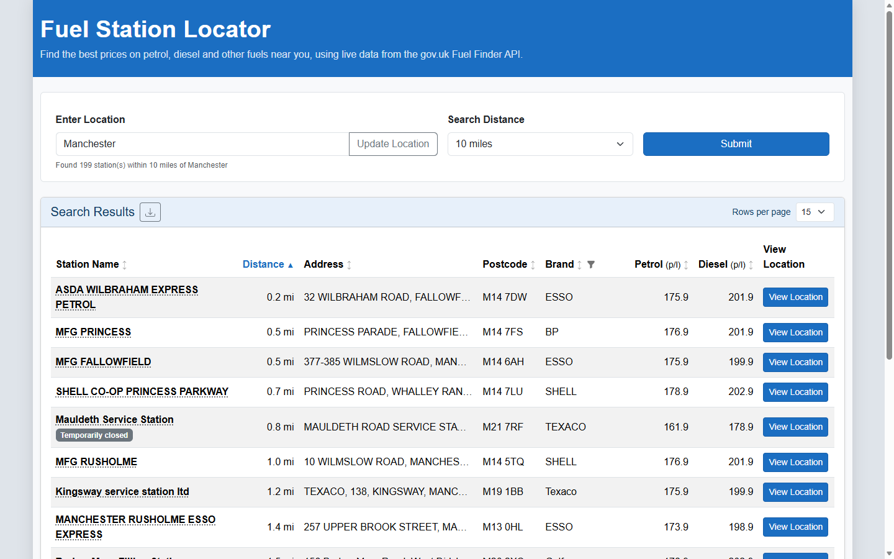
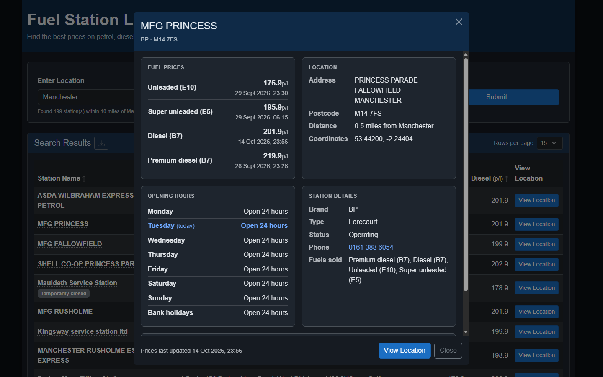
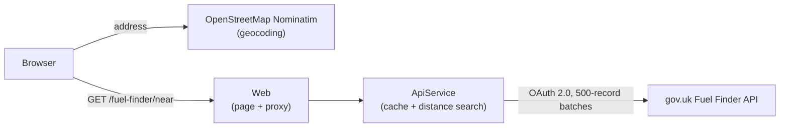

# Fuel Station Locator

Find the cheapest petrol and diesel near you, using prices from the UK government's Public API
[Fuel Finder](https://www.gov.uk/guidance/access-the-latest-fuel-prices-and-forecourt-data-via-api-or-email) service.

Enter a postcode, town or address and the site lists every fuel station within your chosen radius,
with current prices, opening hours, amenities and a link to each station on Google Maps.



## Features

- **Location search** – type a postcode, town or address; it is geocoded with OpenStreetMap
  (Nominatim) and searched within 10, 20, 50 or 100 miles.
- **Live prices** – petrol (E10) and diesel (B7) prices for every station, straight from gov.uk.
- **Sortable columns** – sort by station name, distance, address, postcode, brand, petrol or diesel
  price (ascending or descending). Stations with no price always sort last.
- **Brand filter** – tick the brands you want to see, with a search box and per-brand counts.
- **Station details** – click a station name to see all fuel prices (with when they were last
  updated), opening hours for each day and bank holidays, amenities, phone number, station type
  and distance from your search.
- **CSV export** – download the results (sorted and brand-filtered as shown) as a spreadsheet with
  the same detail as the station details window: every fuel price with its update time, opening
  hours for each day, amenities, type, status, phone, address, coordinates and map link.
- **Light and dark themes** – follows your systems setting by default, with a switch in the footer.



## How it works



The app is a [C# .NET Aspire] solution with two services:

- **ApiService** holds the gov.uk API credentials. The Fuel Finder API has no location search: it
  returns every UK forecourt (about 8,100) in batches of 500. On start-up the service logs in with
  OAuth 2.0 client credentials, downloads every forecourt and price batch, and caches them
  (stations for 1 hour, prices for 15 minutes). It stays within
  the API's limits of one request at a time and 60 requests per minute. Each search filters the
  cached stations by distance using the Haversine formula.
- **Web** serves the page and forwards searches to the ApiService, so credentials never reach the
  browser. Sorting, filtering, pagination, export and the details window all run in the browser
  (`wwwroot/app.js`).

## Prerequisites

- [.NET 10 SDK](https://dotnet.microsoft.com/download)
- Optional: the [Aspire CLI](https://aspire.dev/get-started/install-cli/) (`aspire run`)
- **gov.uk Fuel Finder API credentials** (a client ID and client secret). Register through the
  [Fuel Finder developer portal](https://www.developer.fuel-finder.service.gov.uk/) for free; access
  requires a GOV.UK One Login.

## Getting started

### 1. Store your API credentials

Credentials are kept in .NET [user secrets](https://learn.microsoft.com/aspnet/core/security/app-secrets),
outside the repository:

```bash
dotnet user-secrets set "Parameters:fuelfinder-client-id" "<your client id>" --project Fuel_Station_Locator.AppHost
dotnet user-secrets set "Parameters:fuelfinder-client-secret" "<your client secret>" --project Fuel_Station_Locator.AppHost
```

If you skip this step, the Aspire dashboard asks for the values when the app starts.

### 2. Run the app

```bash
aspire run
```

or, without the Aspire CLI:

```bash
dotnet run --project Fuel_Station_Locator.AppHost
```

The Aspire dashboard opens (normally at https://localhost:7153). Open the **webfrontend** link
to use the site (normally https://localhost:7052).

The first search after start-up can take up to about 30 seconds while every forecourt is
downloaded from gov.uk. After that, searches are answered from the cache in milliseconds.

### Running without Aspire

Each service can also run on its own. Start the ApiService with the credentials as environment
variables (PowerShell shown):

```powershell
$env:FuelFinderApi__ClientId = "<your client id>"
$env:FuelFinderApi__ClientSecret = "<your client secret>"
dotnet run --project Fuel_Station_Locator.ApiService --launch-profile http
```

Then, in a second terminal:

```bash
dotnet run --project Fuel_Station_Locator.Web --launch-profile http
```

Open http://localhost:5182. In Development the Web app finds the ApiService at
http://localhost:5585 (set in `Fuel_Station_Locator.Web/appsettings.Development.json`).

## Configuration

ApiService settings (`Fuel_Station_Locator.ApiService/appsettings.json`):

| Setting | Default | Description |
|---|---|---|
| `FuelFinderApi:BaseUrl` | `https://www.fuel-finder.service.gov.uk/api/v1` | gov.uk Fuel Finder API base URL |
| `FuelFinderApi:ClientId` | – | OAuth client ID (supplied by the AppHost from user secrets) |
| `FuelFinderApi:ClientSecret` | – | OAuth client secret (supplied by the AppHost from user secrets) |
| `FuelFinderApi:StationCacheMinutes` | `60` | How long forecourt details are cached |
| `FuelFinderApi:PriceCacheMinutes` | `15` | How long prices are cached |

## API

The ApiService (and the Web app, which forwards to it) exposes one endpoint:

```http
GET /fuel-finder/near?latitude=51.5013&longitude=-0.1418&maxDistanceMiles=5
```

It returns open stations within the radius, nearest first, each with its address, coordinates,
brand, phone number, distance, amenities, opening hours, fuel types sold and current prices
(`e10`, `e5`, `b7_Standard`, `b7_Premium`, `b10`, `hvo`, in pence per litre). If the gov.uk API
can't be reached it returns `502` with a problem-details body.

`Fuel_Station_Locator.ApiService/Fuel_Station_Locator.ApiService.http` has a ready-made request
for Visual Studio and VS Code.

## Tests

```bash
dotnet test
```

`Fuel_Station_Locator.Tests` starts the whole application with Aspire's testing host and checks
that the search page loads. It uses dummy credentials, so it needs neither real secrets nor
access to gov.uk.

## Project structure

```
Fuel_Station_Locator/
├── Fuel_Station_Locator.AppHost/          Aspire host: starts both services, supplies credentials
├── Fuel_Station_Locator.ApiService/       gov.uk client, caching and distance search
│   ├── Controllers/FuelFinderController.cs    GET /fuel-finder/near
│   ├── Services/FuelFinderClient.cs           OAuth, batch paging, rate limiting, caching
│   └── Models/PetrolStation.cs                Response model
├── Fuel_Station_Locator.Web/              The website
│   ├── Components/Pages/Home.razor            Page markup
│   ├── wwwroot/app.js                         Search, sorting, filtering, export, details window
│   ├── wwwroot/app.css                        Layout and light/dark themes
│   └── Program.cs                             Serves the page and forwards searches
├── Fuel_Station_Locator.ServiceDefaults/  Shared Aspire defaults (telemetry, health checks, resilience)
├── Fuel_Station_Locator.Tests/            Aspire integration test
└── docs/images/                           Screenshots for this README
```

## Data and attribution

- Fuel prices and forecourt details come from the
  [gov.uk Fuel Finder](https://www.gov.uk/guidance/access-the-latest-fuel-prices-and-forecourt-data-via-api-or-email)
  service. Use of the API is subject to its
  [developer guidelines](https://www.developer.fuel-finder.service.gov.uk/fuel-finder/dev-guideline).
- Address search uses [Nominatim](https://nominatim.org/), with data © OpenStreetMap contributors
  ([ODbL](https://www.openstreetmap.org/copyright)). Please follow the
  [Nominatim usage policy](https://operations.osmfoundation.org/policies/nominatim/).

## Licence

[MIT](LICENSE)
